# Defocused Imaging in a Cassegrain Reflector with a 3-Vane Spider — Summary of Findings

Fourier-optics simulation study of how a point source (and later an extended source)
appears at the image plane of a Cassegrain telescope whose secondary mirror is held
by a triangular 3-leg (3-vane) spider, as a function of defocus, source size,
vibration and system parameters.

## 1. Optical model and baseline system

The image of a point source is the point spread function (PSF), computed as
$\mathrm{PSF} = |\mathrm{FFT}\{P\}|^2$ with the complex pupil

$$P(x, y) = A(x, y)\,\mathrm{exp}\left[\, i\, 2\pi\, W_{020}\, \rho^2 \right]$$

where $A$ is the aperture: an annulus (primary minus central obstruction) with three
vane shadows subtracted and $W_{020}$ is the defocus coefficient in waves at the
pupil edge. An extended incoherent source is
handled as PSF convolved with the source disk. Sampling is adaptive so the defocus
phase never aliases (grid grows as $16\cdot|W_{020}|$ samples across the pupil).

Baseline system:

| Parameter | Value |
| --- | --- |
| Primary diameter D | 200 mm |
| Focal ratio F# | 10 (f = 2000 mm) |
| Central obstruction ε | 0.35 |
| Spider | 3 vanes, 4 mm wide, at 90° / 210° / 330° |
| Wavelength λ | 550 nm |

Useful scales for this system:

| Quantity | Value |
| --- | --- |
| $\lambda/D$ (diffraction angle unit) | 0.567 arcsec |
| Airy radius ($1.22\,\lambda\,F\#$) | 6.7 µm |
| Focus shift per wave of $W_{020}$ ($8\,\lambda\,F\#^2$) | 0.44 mm |
| Image-plane sampling used ($\lambda\,F\#/2$, Nyquist) | 2.75 µm |

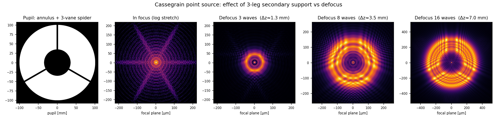

## 2. Point source through focus

### 2.1 Morphology from focus to the geometric limit

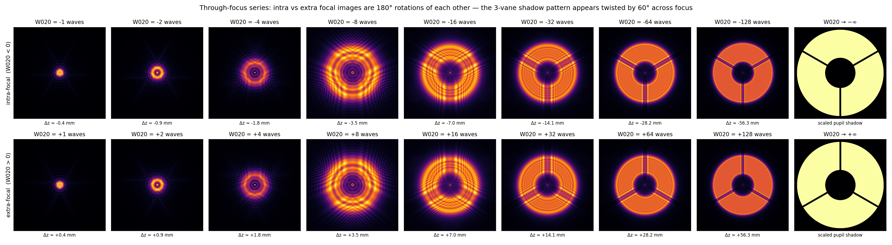

- **In focus**: Airy-like core plus **6 diffraction spikes** — each vane produces a
  spike pair perpendicular to itself; 3 vanes at 120° give spikes every 60°.
- **1–2 waves**: still Airy-like; only ring contrast changes. The spider geometry is
  not recognizable yet.
- **2–4 waves**: the centre darkens — first appearance of the obstruction shadow.
- **8–16 waves**: clear donut; the 3 vane shadows emerge, heavily "beaded" by
  diffraction along their edges.
- **32–128 waves**: the image converges to a scaled copy of the pupil: sharp annulus
  with 3 clean dark legs; Fresnel edge fringes become relatively finer ($\propto 1/\sqrt{W}$).
- $W_{020} \to \infty$: pure geometric limit — the image is exactly the scaled pupil shadow.

### 2.2 Spot size vs defocus

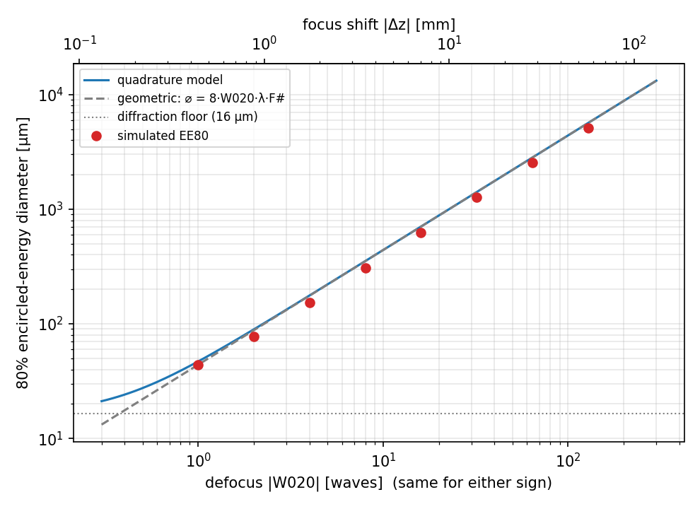

The 80%-encircled-energy diameter follows a quadrature law: a diffraction floor of
16 µm below ~1 wave, then the geometric line $\varnothing = 8\,W_{020}\,\lambda\,F\#$.

| $W_{020}$ [waves] | $\Delta z$ [mm] | EE80 diameter [µm] |
| --- | --- | --- |
| 0 | 0.0 | 16 |
| 1 | 0.4 | 44 |
| 4 | 1.8 | 154 |
| 16 | 7.0 | 622 |
| 64 | 28.2 | 2558 |
| 128 | 56.3 | 5104 |

### 2.3 Which side of focus am I on?

For pure defocus, $\mathrm{PSF}(-W)$ is the exact point reflection (180° rotation) of $\mathrm{PSF}(+W)$.
Because a 3-vane spider has odd (3-fold) symmetry, this rotation is visible: **the
leg-shadow triangle appears twisted by 60° when crossing focus** (with a 4-vane
spider the effect is invisible, since 4-fold patterns are unchanged by 180°).
This gives a practical way to tell intra- from extra-focal images with a 3-leg
telescope: the orientation of the single vertical leg shadow flips up/down.

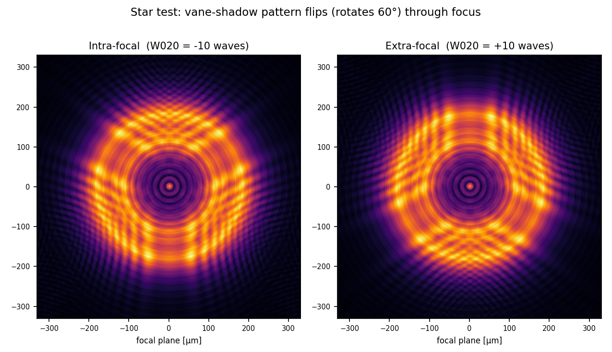

## 3. Extended (non point-like) sources

### 3.1 Model

An incoherent source of angular diameter $\theta_d$ multiplies every angular frequency $q$
of the image by the uniform-disk visibility $\frac{2\,J_1(\pi\,\theta_d\,q)}{\pi\,\theta_d\,q}$. This was
applied analytically in the frequency domain (exact for arbitrarily small sources).

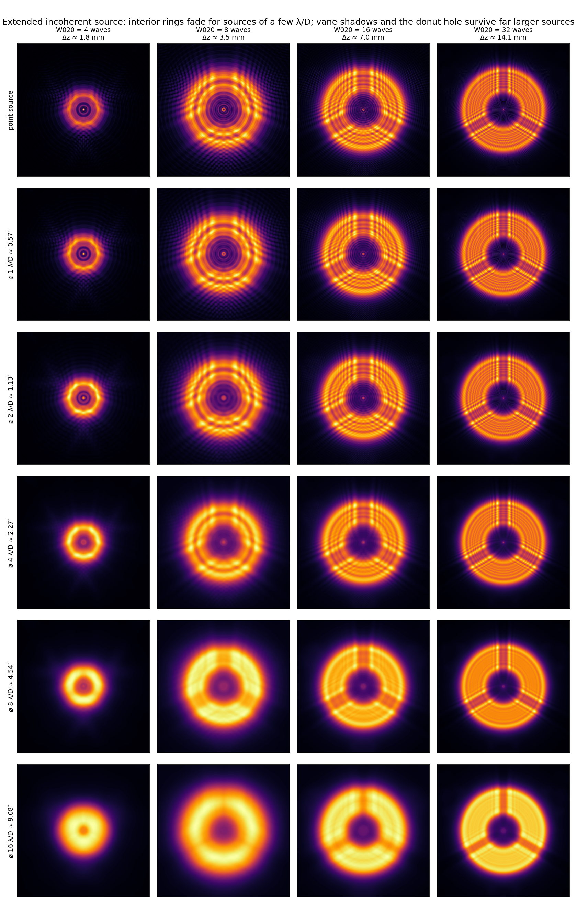

### 3.2 Feature survival hierarchy

**A feature survives as long as its own angular width exceeds the source diameter.**
The defocused donut contains features of very different scales, so they die in
strict order as the source grows:

| Feature | Angular scale | Fate as source grows |
| --- | --- | --- |
| Finest edge fringes | $\sim 1\,\lambda/D$, defocus-independent | Gone first, at $\sim 1\,\lambda/D$ (0.57″) |
| Interior donut rings | $\sim 7\,\lambda/D$ period (edge-wave beats), defocus-independent | Essentially gone by $8{-}16\,\lambda/D$ |
| Vane (leg) shadows | $0.16\,W_{020}\,\lambda/D$ — grows with defocus | Die when source exceeds their width; more defocus revives them |
| Central hole | $2.8\,W_{020}\,\lambda/D$ | Dies last, only when source ≈ hole |

Measured ring contrast at $W_{020} = 32$ vs the analytic disk-visibility law (evaluated
at the measured ring frequency, period $7.3\,\lambda/D$ = 4.15″):

| Source diameter | Measured contrast ratio | Theory $2J_1(x)/x$ |
| --- | --- | --- |
| point | 1.00 | 1.00 |
| $1\,\lambda/D$ (0.57″) | 0.95 | 0.98 |
| $2\,\lambda/D$ (1.13″) | 0.87 | 0.91 |
| $4\,\lambda/D$ (2.27″) | 0.64 | 0.67 |
| $16\,\lambda/D$ (9.08″) | 0.12 | ~0 (broadband residual) |

Key cross-checks from the survival matrices:

- A 9″ source erases the leg shadows at $W_{020} = 4$ (contrast 0.20 → 0.04) but they
  **reappear** at $W_{020} = 32$ (0.34) because the shadow width grows with defocus.
  The rings never come back — their angular period does not scale with defocus.
- The donut hole stays dark (depth ≥ 0.97) at $W_{020} = 32$ even for a 9″ source, but
  is mostly filled (0.39) at $W_{020} = 4$ where the hole is only $11\,\lambda/D$ wide.
- The exact centre of the shadow contains a bright axial (Arago-type) spot from
  the annular aperture; an extended source smears and eventually removes it.

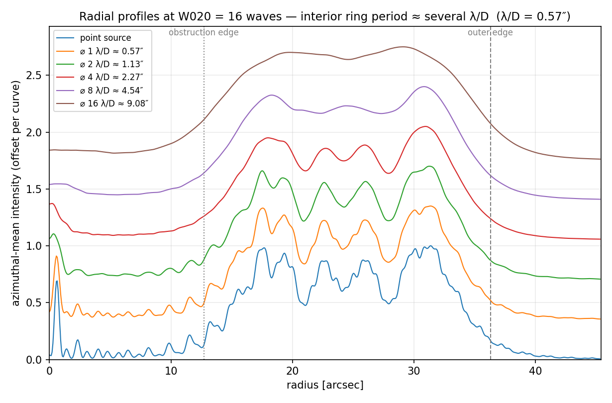

### 3.3 Practical implications

- Atmospheric seeing acts exactly like an extra source diameter: in 2″ seeing this
  200 mm system never shows the fine fringes — only the smooth donut, with leg
  shadows visible only at large defocus.
- Any source (or seeing disk) larger than $\sim 4\,\lambda/D$ ≈ 2.3″ leaves a smooth donut whose
  only structure is the 3 leg shadows.

### 3.4 The central (Arago) spot vs source size

The annular shadow produces a bright axial (Poisson–Arago) spot at the exact
centre of the hole: edge waves from the whole inner shadow boundary arrive in
phase on axis. For an extended source this feature is the axial core convolved
with the source disk — a central **image of the source** inside the hole.

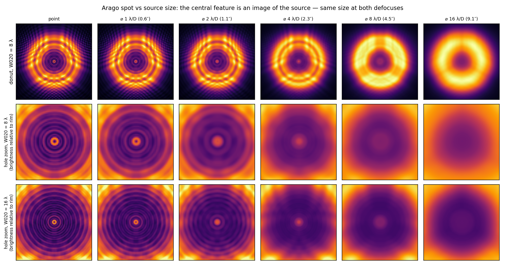

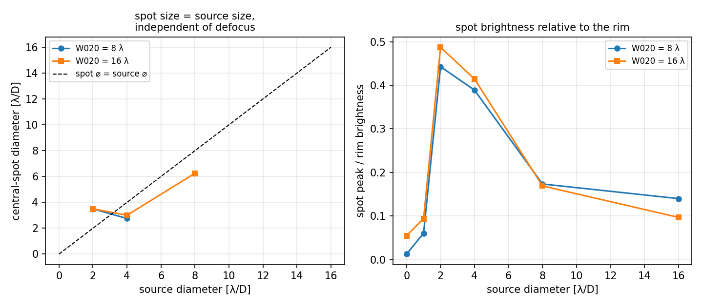

| Source ⌀ | Spot ⌀ | Spot/hole ($W_{020}=8$) | Brightness vs rim ($W_{020}$ = 8 / 16) |
| --- | --- | --- | --- |
| point | core invisible | — | 0.01 / 0.06 (sits in an axial null) |
| $1\,\lambda/D$ (0.6″) | barely there | — | 0.06 / 0.09 |
| $2\,\lambda/D$ (1.1″) | $3.5\,\lambda/D$ | 16% | 0.44 / 0.49 — clearly visible |
| $4\,\lambda/D$ (2.3″) | $\sim 3\,\lambda/D$ | 12% | 0.39 / 0.41 |
| $8\,\lambda/D$ (4.5″) | $\sim 6\,\lambda/D$, merging | — | 0.17 |
| $16\,\lambda/D$ (9.1″) | merged into hole | — | 0.14 / 0.10 |

- A modest source **brightens** the spot dramatically: the point-source spot
  sits in an interference null at these defocuses (0.01–0.06 of the rim), while
  a 1–2″ source averages over the nulls and lifts it to ~0.45 of the rim.
- The spot diameter equals the source diameter and is **independent of
  defocus** ($3.5\,\lambda/D$ at both $W_{020}$ = 8 and 16 while the hole
  doubles) — the fingerprint separating it from a ghost or aberration caustic.
- There is a ceiling: *bright and distinct* happens only for sources of
  2–4 $\lambda/D$, where the spot stays small (≤16% of the hole diameter, <3%
  of its area). A spot filling a significant part of the hole requires a source
  approaching the hole size — which dims it to ~0.15 of the rim and washes out
  the donut's own rings and leg shadows at the same time.
- Diagnostic: a large bright central spot **next to a crisp, structured donut**
  cannot be the Arago spot — suspect a ghost reflection or spherical
  aberration. Only a smooth washed-out donut is consistent with a
  source-enlarged Arago image (e.g. a defocused planet).

## 4. Vibration blur

During an exposure much longer than the vibration period, the image is the
time-average of displaced copies of itself. In the frequency domain this
multiplies the image spectrum by a vibration MTF:

- Random jitter (many uncorrelated cycles, RMS $\sigma$): isotropic Gaussian factor
  $\mathrm{exp}(-2\pi^2\sigma^2 q^2)$ — monotonic suppression, similar to seeing.
- Sinusoidal vibration (single resonance, amplitude $a$ along one axis): arcsine
  dwell kernel with factor $J_0(2\pi\, a\, q_{\parallel})$ — directional, with sign
  reversals.

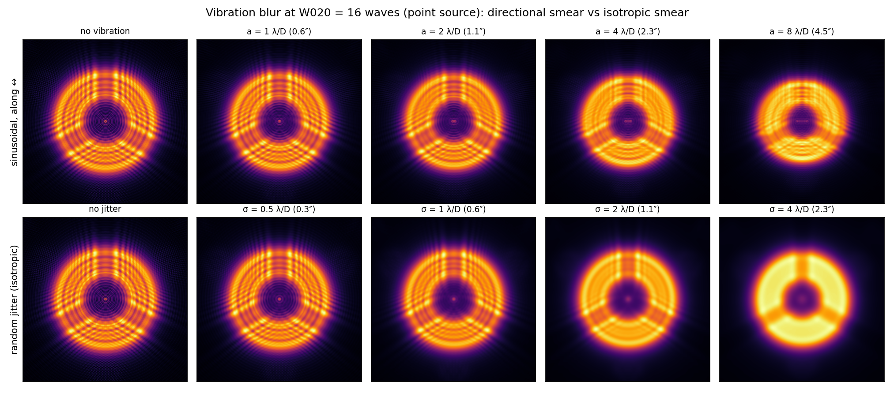

### 4.1 Effect on the ring pattern (point source, $W_{020} = 16$)

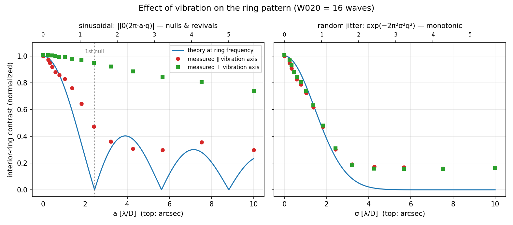

- **Random jitter** suppresses rings isotropically and monotonically; by
  $\sigma \approx 1\,\lambda/D$ they are heavily attenuated, with no recovery.
- **Sinusoidal vibration is directional**: ring contrast perpendicular to the
  vibration axis stays ≈ 1 (0.94 measured at $a = 2.4\,\lambda/D$) while along the
  axis it collapses through the first $J_0$ null at the predicted
  $a = 2.405/(2\pi q_{ring}) = 2.5\,\lambda/D$ (1.4″) and then **revives with
  reversed contrast**: measured 0.36/0.31 at $a$ = 3.2–4.3 $\lambda/D$, matching
  the $J_0$ side-lobe magnitudes (0.31/0.38).
- The measured contrast does not reach zero at the null (0.47 vs 0.02) because the
  ring spectrum is broadband — $J_0$ nulls only one frequency at a time.
- At large amplitude the donut grows a doubled bright rim along the axis — the two
  turning points of the oscillation, where the line of sight dwells longest.

| $a$ [λ/D] | measured ∥ | theory $J_0$ (magnitude) | measured ⊥ |
| --- | --- | --- | --- |
| 1.0 | 0.83 | 0.76 | 0.99 |
| 1.8 | 0.64 | 0.35 | 0.97 |
| 2.4 (null) | 0.47 | 0.02 | 0.94 |
| 3.2 (revival) | 0.36 | 0.31 | 0.92 |
| 10.0 | 0.30 | 0.23 | 0.74 |

### 4.2 Vibration on an extended source

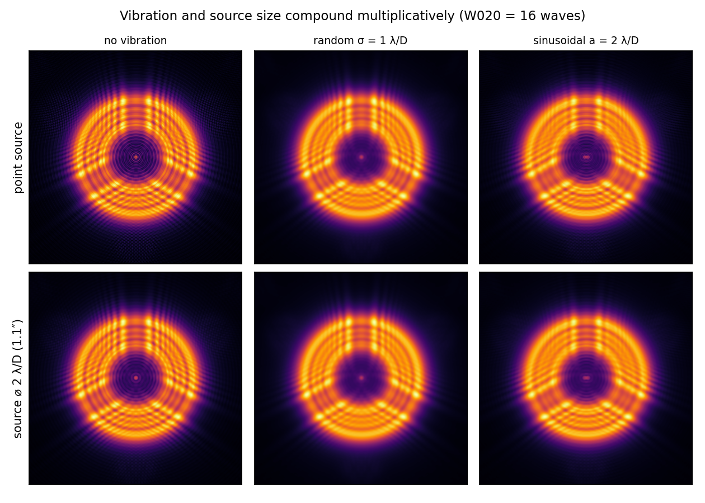

Vibration and source-size attenuations are both linear-system MTF factors, so they
compound multiplicatively (verified: source 0.86 × vibration 0.59 = 0.51 predicted
vs 0.57 measured). A modest resonance on top of a $2\,\lambda/D$ source leaves
textureless donut arcs along the vibration axis while rings survive perpendicular
to it — the anisotropy outlives the source blur.

### 4.3 Diagnostics

- Rings weak in one direction only, elongated donut, doubled rim → mechanical
  resonance; the smear direction points at the culprit.
- Rings weak everywhere but donut edge still sharp → random jitter, or an extended
  source / seeing.
- Ring contrast vanishing and reappearing as amplitude varies → sweeping a $J_0$
  null; the first null calibrates the amplitude via $a = 2.405/(2\pi q_{ring})$.

## 5. What sets the donut size — parameter study

### 5.1 Size laws (verified by simulation)

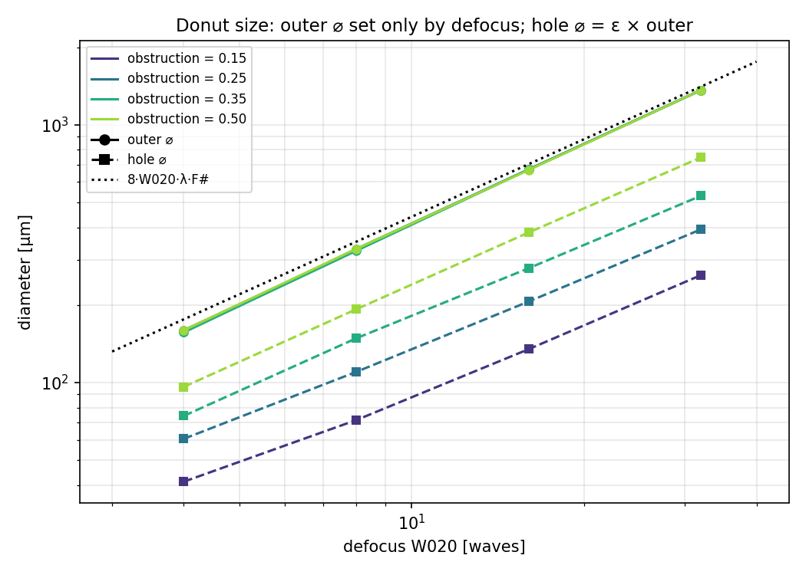

| Feature | Law | Verified |
| --- | --- | --- |
| Donut outer diameter | $\varnothing = 8\,W_{020}\,\lambda\,F\# = \Delta z/F\# = D\,\Delta z/f$ | identical across $\varepsilon$ = 0.15–0.50 to <1%; ~3% below prediction (half-light edge sits inside the diffraction-softened rim) |
| Hole diameter | $\varepsilon \times$ outer $\varnothing$ | e.g. 748/704 µm at $\varepsilon$ = 0.5, $W_{020}$ = 32 |
| Vane shadow width | max(geometric $(w/D)\cdot\varnothing$, Fresnel floor $\sqrt{\lambda\,\Delta z}$) | see 5.3 |

Consequences:

- **Defocus** $\Delta z$ is the only parameter that grows the donut (linearly).
- **Focal ratio** $F\#$: faster optics → bigger blur for the same $\Delta z$.
- **Wavelength** does not change the geometric size at fixed $\Delta z$ — it only sets the
  fringe fine-structure (and converts $\Delta z$ into waves).
- **Obstruction and vane width never change the donut size** — they only reshape
  the intensity inside it.

### 5.2 Central obstruction

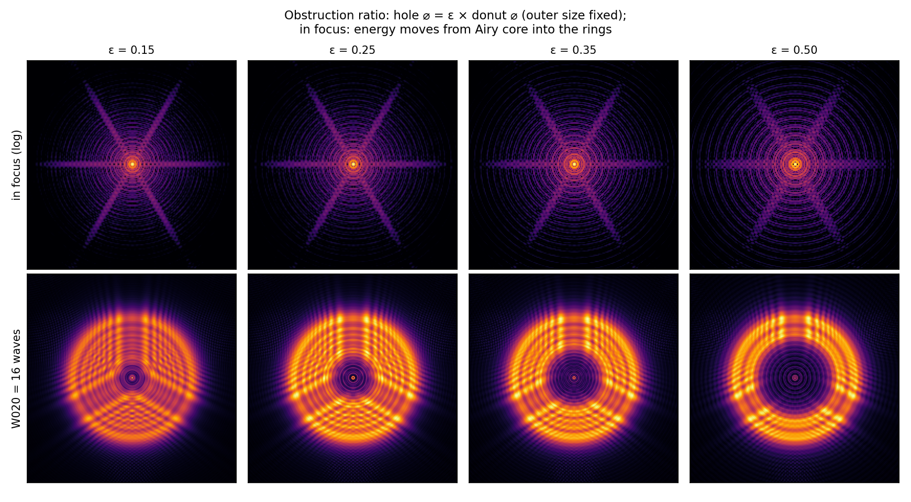

- Defocused: hole diameter strictly $\propto \varepsilon$; the bright annulus thins accordingly
  (same energy in less area).
- In focus: energy moves from the Airy core into the rings — the classic contrast
  penalty of a large secondary. The 6-spike pattern is unaffected.

### 5.3 Vane (leg) width — a diffraction surprise

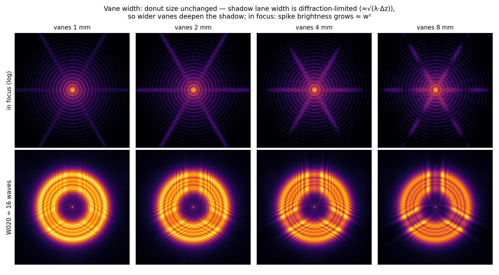

At $W_{020} = 16$ the geometric shadow of a 1–8 mm vane would be 4–28 µm wide, but the
Fresnel diffraction scale is $\sqrt{\lambda\,\Delta z} \approx 62$ µm. The lane width therefore **saturates
at the diffraction floor (~90–103 µm measured, nearly independent of vane width)**
and the vane width instead controls the **shadow depth**:

| Vane width | Shadow FWHM [µm] (geometric) | Shadow depth | In-focus spike excess |
| --- | --- | --- | --- |
| 1 mm | 103 (4) | 0.16 | 1.0e-05 |
| 2 mm | 102 (7) | 0.29 | 3.2e-05 |
| 4 mm | 98 (14) | 0.47 | 9.4e-05 |
| 8 mm | 90 (28) | 0.68 | 2.6e-04 |

- In focus, spike brightness grows ≈ ×3–4 per doubling of vane width ($\sim w^2$ law).
- Design trade-off: thin legs cost little in the defocused image (their shadows
  fade rather than narrow) but pay off quadratically in reduced in-focus spikes.
- To see cleanly separated geometric leg shadows, rack out far enough that
  $(w/D)\,\Delta z/F\# \gtrsim \sqrt{\lambda\,\Delta z}$.

## 6. Formula sheet

| Quantity | Formula ($W_{020}$ in waves) |
| --- | --- |
| Defocus phase | $\varphi(\rho) = 2\pi\,W_{020}\,\rho^2$ |
| Focus shift per wave | $\Delta z = 8\,\lambda\,F\#^2\,W_{020}$ |
| Donut outer diameter | $\varnothing = 8\,W_{020}\,\lambda\,F\# = \Delta z/F\#$ |
| Donut hole diameter | $\varepsilon \cdot 8\,W_{020}\,\lambda\,F\#$ |
| Geometric vane shadow width | $(w_{vane}/D) \cdot 8\,W_{020}\,\lambda\,F\#$ |
| Fresnel width floor | $\sqrt{\lambda\,\Delta z}$ |
| Diffraction angle unit | $\lambda/D$ (= 0.567″ here); focal-plane length $\lambda\,F\#$ |
| Disk-source attenuation at frequency $q$ | $2\,J_1(\pi\,\theta_d\,q)\,/\,(\pi\,\theta_d\,q)$ |
| Random-jitter MTF (RMS $\sigma$) | $\mathrm{exp}(-2\pi^2\sigma^2 q^2)$ |
| Sinusoidal-vibration MTF (amplitude $a$) | $J_0(2\pi\, a\, q_{\parallel})$; first ring null at $a = 2.405/(2\pi q_{ring})$ |
| Central (Arago) spot with an extended source | spot ⌀ = source ⌀ (defocus-independent); brightest for sources ≈ 2–4 $\lambda/D$ |
| Sign of defocus | $\mathrm{PSF}(-W)$ = 180° rotation of $\mathrm{PSF}(+W)$ → 60° twist of the 3-leg pattern |

## 7. Interactive simulators

Two feature-identical real-time simulators accompany the study: a
Python/Tkinter application (cassegrain_gui.py) and a MATLAB port
(cassegrain_simulator.m, R2019b+, no toolboxes). Both expose the full model of
this report at interactive speed.

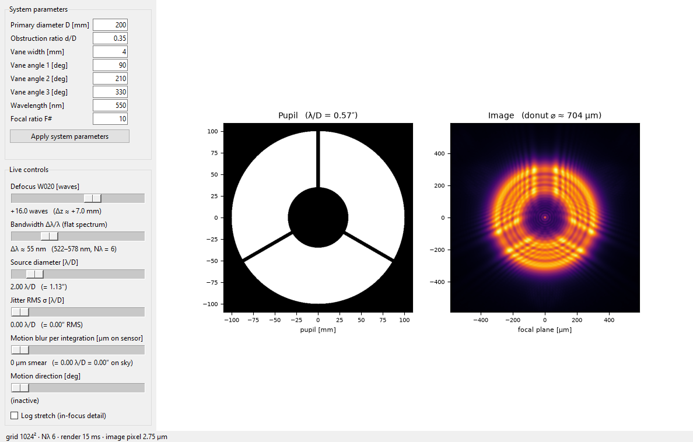

**System parameters** (text fields, applied together, with validation):
primary diameter $D$ [mm], obstruction ratio $\varepsilon$, vane width [mm],
three independent vane angles [deg] (asymmetric spiders allowed), lower and
upper wavelength [µm], focal ratio $F\#$. Equal endpoints are monochromatic;
otherwise the simulator adds flat-band intensities on a common grid (THEORY §7.3).

**Live controls** (sliders, with physical readouts under each):

| Control | Range | Physics applied |
| --- | --- | --- |
| Defocus $W_{020}$ | ±64 waves, 0.5 steps | quadratic pupil phase; readout shows $\Delta z$ [mm] |
| Source diameter | 0–16 $\lambda/D$ | uniform-disk visibility $2J_1(x)/x$; arcsec readout |
| Jitter RMS $\sigma$ | 0–4 $\lambda/D$ | Gaussian MTF $\mathrm{exp}(-2\pi^2\sigma^2 q^2)$ |
| Motion blur | 0–300 µm on sensor, direction 0–180° | drift MTF $\mathrm{sinc}(L\,q_{\parallel})$; smear length per integration |

**Displays**: the pupil (mm axes, redrawn when system parameters are applied)
and the resulting image (focal-plane µm axes, γ = 0.5 stretch, optional log
stretch for in-focus detail), with the predicted donut diameter in the title
and a status bar showing grid size, $N_\lambda$ and render time.

**Numerics** — adaptive pupil sampling
(512/1024 samples for $|W_{020}| \leq$ 32/64, the same $16|W_{020}|$
anti-aliasing rule), short-edge Nyquist image sampling ($\lambda_{\min} F\#/2$ per pixel),
single precision. Grid geometry, the PSF spectrum (keyed by defocus ×
bandwidth) and the combined blur MTF are cached, so only the slider being
moved re-triggers its expensive stage. Broad bands at large defocus can
require many FFTs. Images are peak-normalized (no absolute photometry).

Both programs include a headless self-test (`python simulator/cassegrain_gui.py
--selftest` / `cassegrain_simulator selftest`) printing identical validation
cases, so the two implementations can be cross-checked line by line.

## 8. Files and reproduction

| Script | Purpose | Figures produced |
| --- | --- | --- |
| cassegrain_defocus_sim.py | Point-source model, through-focus series, spot size | cassegrain_pupil_and_psfs.png, cassegrain_star_test.png, cassegrain_defocus_series.png, cassegrain_spot_size.png |
| cassegrain_extended_source_sim.py | Extended-source imaging, feature-survival analysis | cassegrain_extended_source_gallery.png, cassegrain_extended_source_rings.png, cassegrain_extended_source_profiles.png |
| cassegrain_parameter_study.py | Donut size laws, obstruction and vane-width studies | cassegrain_donut_size_study.png, cassegrain_obstruction_study.png, cassegrain_vane_width_study.png |
| cassegrain_vibration_sim.py | Vibration blur: random jitter and sinusoidal resonance, ring-contrast analysis | cassegrain_vibration_gallery.png, cassegrain_vibration_ring_contrast.png, cassegrain_vibration_extended_source.png |
| cassegrain_arago_vs_source.py | Central (Arago) spot vs source size | cassegrain_arago_vs_source_gallery.png, cassegrain_arago_vs_source_metrics.png |
| cassegrain_gui.py | Interactive simulator (Tkinter): all effects of this report in real time | — (interactive) |
| cassegrain_simulator.m | MATLAB port of the simulator (R2019b+, no toolboxes) | — (interactive) |

Batch scripts live in studies/ and the simulators in simulator/. Run from the
project folder with `python studies/<script>.py` (requires numpy, matplotlib,
scipy); figures are written to docs/figures/. All system
parameters are constants at the top of cassegrain_defocus_sim.py; the study scripts
override obstruction / vane width per case via make_pupil() arguments.
